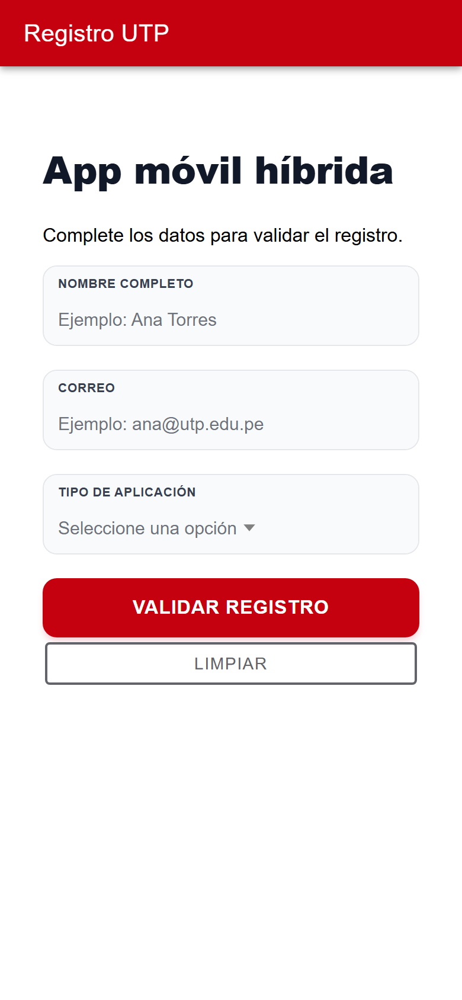
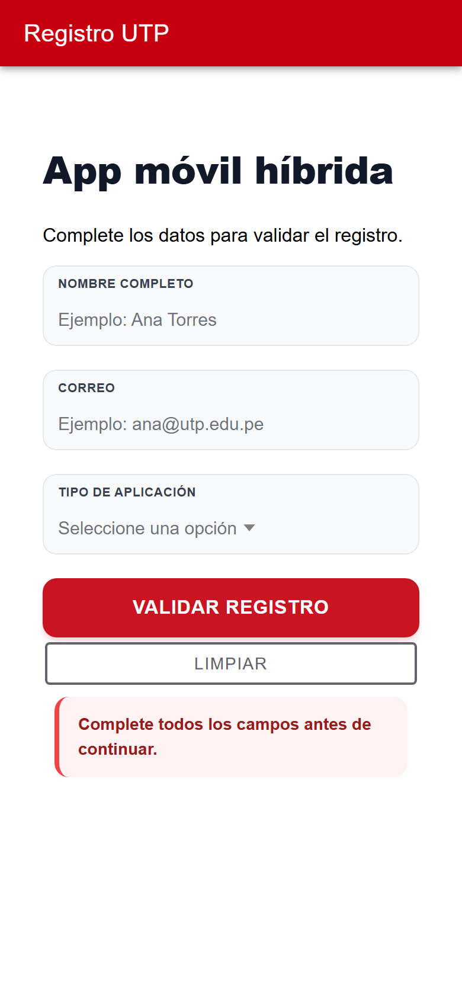
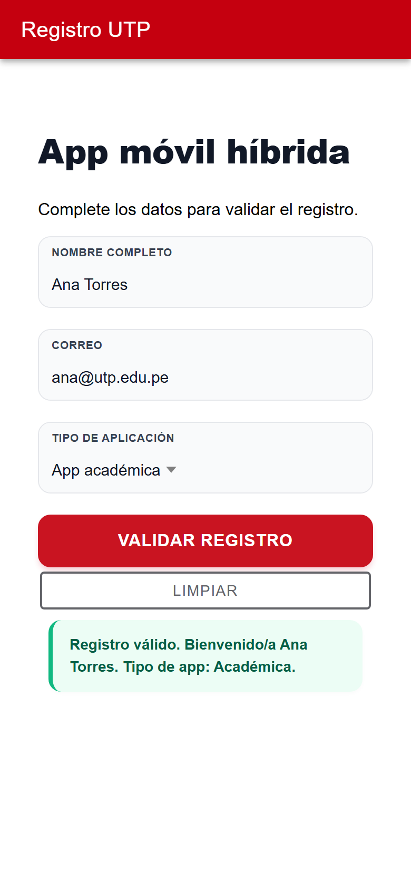

<p align="center">
  <a href="https://github.com/Nakusuo"></a>
</p>

# Registro UTP · Semana 11

Mi primera **app móvil híbrida**: un formulario de registro hecho con **Ionic + Angular** que revisa los datos antes de dejarte continuar. La hice para la semana 11 del curso, y con Capacitor se puede instalar en Android.

| Formulario | Si falta algo | Registro válido |
|---|---|---|
|  |  |  |

## Qué hace

Pides nombre, correo y tipo de aplicación (académica, ventas o soporte). Al tocar **Validar registro**, la app revisa que no falte nada y que el correo tenga forma de correo:

- si algo está mal, aparece una tarjeta roja diciendo qué corregir;
- si todo está bien, una tarjeta verde te da la bienvenida con tu nombre y el tipo de app elegido.

**Limpiar** borra el formulario para empezar de nuevo. Todo pasa dentro del celular, sin servidor: la idea era aprender lo básico de Ionic (componentes, `ngModel` y estilos por estado).

En la [semana 14](https://github.com/Nakusuo/semana14-DWI) la llevé más lejos: formularios reactivos y guardado en una API.

## Con qué está hecha

Ionic 8, Angular 20, TypeScript y Capacitor para Android.

## Cómo correrla

```bash
cd app-utp
npm install
npm start          # http://localhost:4200
```

Para generar el APK de Android:

```bash
./generar-apk.sh
```
